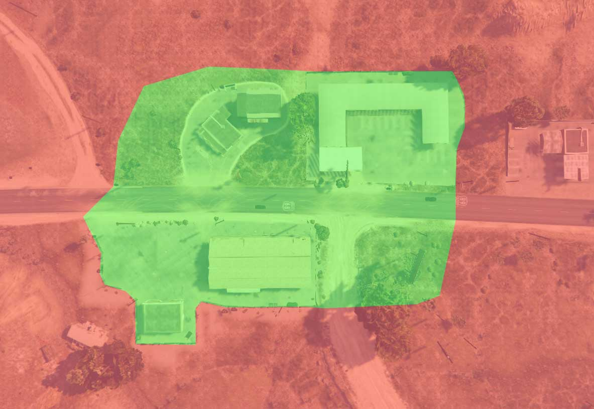
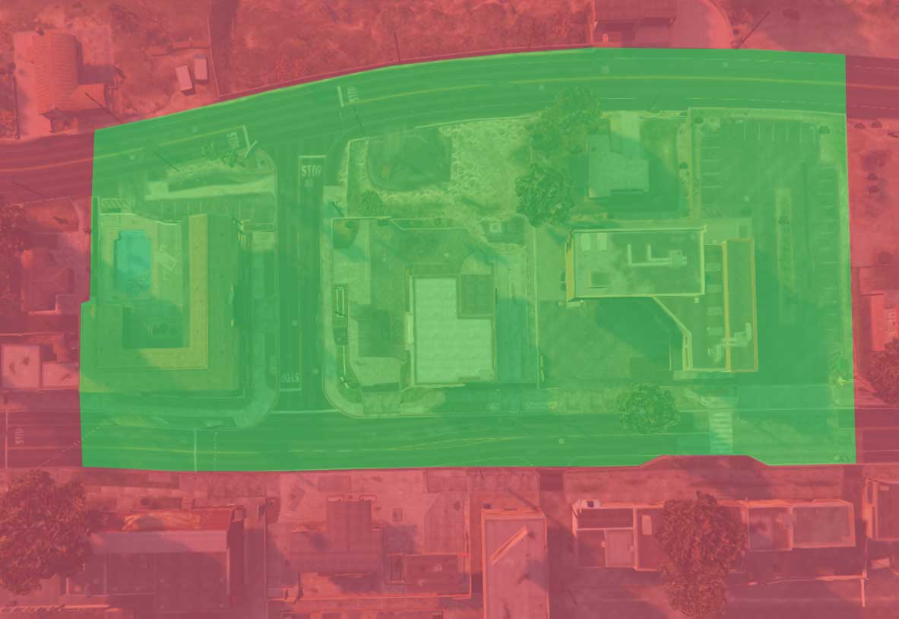
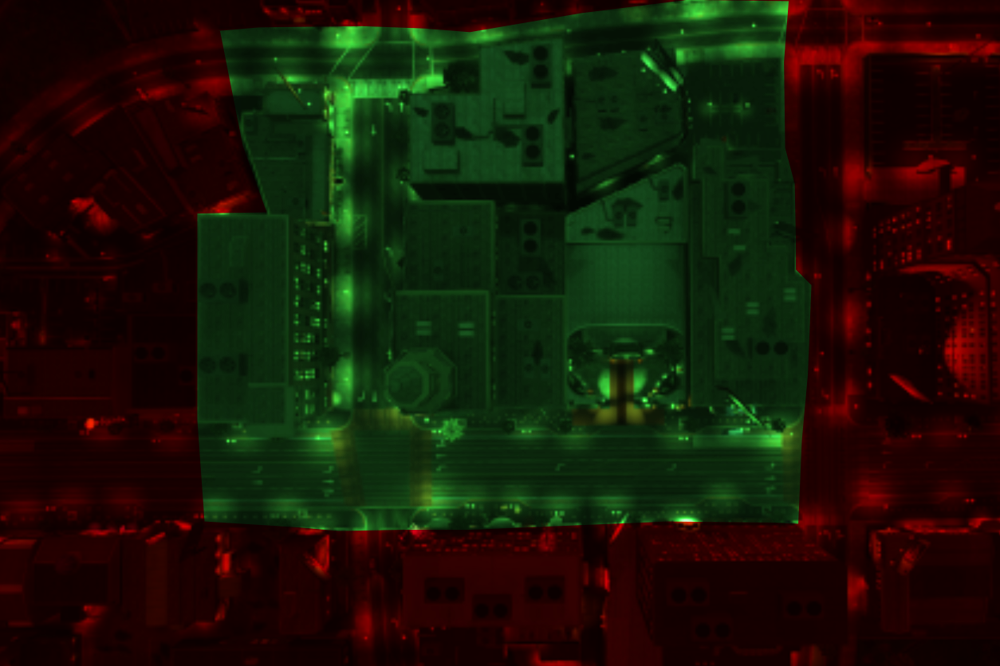
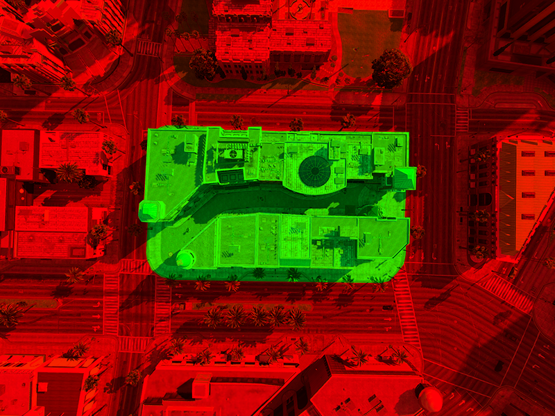
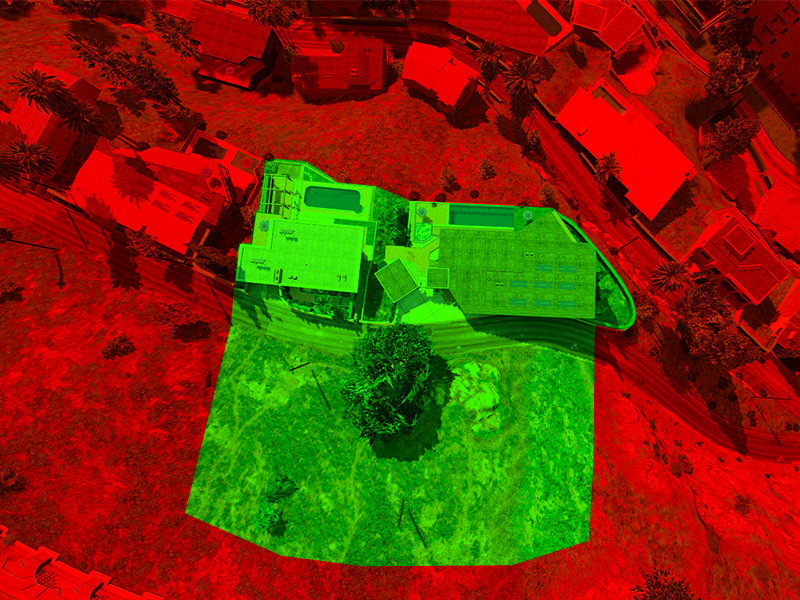

# REGRAS DE AÇÃO

## Regras Gerais de Ação

* Proibido a utilização de drone em ações.
* Proibido a utilização de k9 em qualquer tipo de ação.
* Proibido iniciar qualquer ação faltando menos de 30 minutos para o RR (reinício do servidor).&#x20;
* Proibido lootear veículos em ações fechadas.
* Proibido voltar para qualquer ação depois de desmaiar, mesmo que seja ressuscitado por algum médico ou bombeiro.
* Permitido lootear players em ações fechadas apenas os seguintes itens: alimentos em geral, munições, armamentos, coletes e kit médicos.&#x20;
* Proibido lootear celulares em ações fechadas a qualquer momento.
* **LOOT DE POLICIAIS EM AÇÕES FECHADAS:** obrigatório reunir todos os corpos dos policiais ao final da ação **EM UM LUGAR ACESSÍVEL DO /DOCTOR** e executar o loot necessário. Ao colocar o último corpo do último policial, os bandidos tem 5 minutos para fazer o saque dos itens (levem o que couber nos bolsos)..
* Após o tempo de 5 minutos, é **OBRIGATÓRIO** os bandidos saírem do local o mais rápido possível.
* Em ação **BLIPADAS OU FECHADAS**, proibido envolver pessoas de fora além das que começaram na ação.
* Em ações com reféns, proibido começar a ação sem estar com **TODOS OS REFÉNS** dentro do local que está sendo roubado.
* **OBRIGATÓRIO:** Qualquer ação que envolva troca de tiros com a polícia e os bandidos cairem, a polícia deve aguardar uma unidade médica para declarar o óbito do bandido, forçando o mesmo a respawnar no hospital. Caso não tenha médico online (ou os mesmos não consigam atender), a polícia pode usar a função no ALT e declarar óbito eles mesmos (a polícia deve apreender todos os itens ILEGAIS antes de declarar o óbito). IMPORTANTE: essa função não tem nada aver em dar PD no personagem. (Essa regra vale para ações de rua e ações blipadas).
* <mark style="color:red;">**PROIBIDO**</mark> usar paraquedas para acessar locais onde é impossível acesso sem algum tipo de transporte.  

## Ação de Roubo de Cargas do Cartel

* Permitido lootear seguindo as [**Regras de Loot**](https://salverp.gitbook.io/salve/~/revisions/uT9k0VgRkac8d6gQRl6k/regras-do-ilegal).
* Proibido união de organizações ilegais.
* Permitido todas as armas de fogo.
* Proibido armas brancas.

## Ação de Raspagem de Chassi

* Número máximo de bandidos: 8.
* Número máximo de policiais: Ilimitado.
* Proibido o uso de armas de fogo entre policiais e bandidos (o foco da ação é a fuga).
* Permitido o bate-bate entre os carros da polícia e do bandido.
* Proibido usar carros para derrubar motos (caso aconteça, armas estão liberadas).

## Ação de Roubo de Carga de Caminhões (farm)

* Número máximo de bandidos por caminhão: 4
* Número máximo de policiais: contingente disponível
* Proibido o uso de armas de fogo entre policiais e bandidos (o foco da ação é a fuga).

## Ação de Roubo de Casas

O foco dessa ação é uma trocação franca apenas com armas brancas.

* Número máximo de bandidos: 4
* Número máximo de policiais: 4
* Armamento permitido: Só no soco, Pé de Cabra, Pedaço de Pau e Cassetete <mark style="color:red;">**(PROIBIDO FACAS E PROIBIDO ARMAS DE FOGO)**</mark>
* Proibido ficar marcando a porta sem dar a oportunidade da reação do player.
* Todos os bandidos envolvidos na ação devem estar bem próximos da casa roubada.
* Não há necessidade de negociação.
* Proibido reféns.

## Ação Roubo a Loja de Conveniência

## Criminosos

Número máximo de bandidos: 4\
Armamento: obrigatório classe 1 (Pistolas)\
**Proibido usar helicópteros nessa ação**

**Regras dos Bandidos**

* Roubar cofre da loja.
* Bandidos devem proteger o cofre pois a polícia pode interromper a ação a qualquer momento.
* Bandidos podem abrir fogo na polícia assim que avistarem uma viatura.
* **OBRIGATÓRIO** 2 bandidos no interior da loja
* **PROIBIDO** fechar a porta da loja com carro com a intenção de bloquear a passagem da polícia
* <mark style="color:red;">**NÃO É NECESSÁRIO NEGOCIAR.**</mark>

## Policia

Número máximo de policiais: 4\
Armamento: obrigatório classe 1 (Pistolas)\
**Proibido usar helicópteros nessa ação**

**Objetivo da Policia**

* Interromper a ação cancelando o processo de abertura do cofre.
* Neutralizar os bandidos que estão roubando a loja.
* **A polícia não precisa abater os bandidos para cancelar o roubo, se não tiver dentro da loja, eles podem cancelar direto!**

<mark style="color:red;">**ESSA AÇÃO DEVE SER FEITA APENAS NO TIRO**</mark>

<mark style="color:red;">**NÃO PRECISA TER REFÉM**</mark>

**Perímetros**

Loja da Praia

<figure><figcaption></figcaption></figure>

Loja do Banco Central

<figure><figcaption></figcaption></figure>

Loja do China

<figure><figcaption></figcaption></figure>

## Ação Roubo ao Carro Forte Protege

* Número Máximo de Bandidos: sem limites.
* Número Máximo de Policiais: sem limites.
* Armamento: obrigatório qualquer arma de fogo.
* Permitido o uso de helicópteros, porém proibido atirar a bordo deles.
* Proibido reféns.
* Obrigatório trocar com os seguranças do carro forte.
* Proibido tentar render ou sequestrar os seguranças (foco dessa ação é trocar tiro).
* Proibido ficar de campana próximo ao galpão do Protege, incluindo a região da ponte para o porto de Santos.

## Ação Lavagem de Dinheiro

### Criminosos

Número **obrigatório** de bandidos: 8 \
Armamento: obrigatório automática\
**Proibido usar helicópteros nessa ação**

**Objetivos dos Bandidos**

* Iniciar operação de lavagem
* Impedir que a policia cancele a operação
* Fugir do local

### Polícia

Número máximo de policias: 10\
Armamento: obrigatório automática\
**Proibido usar helicópteros nessa ação**

**Objetivos da Polícia**

* Impedir que os bandidos concluam a operação, apertando o botão para cancelar no computador

### Descrição da Ação

Nessa ação, os bandidos tem a possibilidade de fazer uma lavagem com lucro mais alto. Pra isso, é necessário iniciar a ação no laptop colocando os rolos de nota no sistema. Nesse momento a polícia será acionada e vai se dirigir até o local.

O sistema vai demorar um tempo pra liberar o valor, e ao final, os bandidos devem confirmar a retirada do valor no computador que está no local. Caso a polícia consiga derrubar todos os bandidos, eles podem ir no computador e <mark style="color:red;">**cancelar a operação**</mark>.

* (Bandidos) Não é necessário derrubar todos os policiais pra fugir.
* (Policia) Não é necessário derrubar todos os bandidos para apertar o botão de <mark style="color:red;">**cancelar a operação**</mark>.
* Pode fugir pelo mar.
* O perímetro para trocação deve ser respeitado.
* Proibido reféns nessa ação.
* Não precisa de negociação.
* Proibido subir nos galpões de qualquer forma possível.
* Depois de iniciada a ação, os participantes só podem deixar o local quando o tempo acabar.

### Perímetro da Ação

<figure><figcaption></figcaption></figure>

## Ação de Roubo ao Banco

### Criminosos

Número máximo: 8 \
Número mínimo de bandidos: 6\
Armamento: obrigatório automática\
Quantidade máxima de veículos para fuga: 2\
Proibido usar motos nessa ação\
Proibido usar helicópteros nessa ação

**Objetivos dos Bandidos**

* Abrir cofre e garantir que a operação termine.
* Impedir que a polícia cancele a operação.
* Fugir com o dinheiro.

### Polícia

Número obrigatório de policiais: 10\
Armamento: obrigatório automática\
Quantidade máxima de unidades por veículo dos bandidos: 4\
**Permitido 1 helicóptero**

**Objetivos da Polícia**

* Interromper a operação do cofre.
* Interceptar os bandidos.

### Descrição da Ação

Nessa ação, os bandidos podem fazer o roubo de duas formas:

* No tiro - nesse cenário não precisa de refém e não tem negociação. Os bandidos podem seguir os mesmos padrões das outras ações abrindo fogo assim que as viaturas chegarem.
* Na fuga - nesse cenário há necessidade de reféns e de negociação. Para identificar a fuga, os bandidos devem deixar os carros que vão utilizar na porta do banco pra deixar claro que estão dispostos a negociar.

**Regras da Ação**

* O que pode ser negociado para fuga: a fuga em si (1 refém), remoção do helicóptero (2 reféns), remoção da rocam (1 refém). Resumindo: pra conseguir negociar tudo, tem que ter 4 reféns no máximo. Se tiver só 1 refém, não poderá remover nada.
* Proibido tentar negociar qualquer outra coisa que não esteja citado na lista acima.
* No caso da retirada do helicóptero e da rocam, a polícia deve colocar carros pra completar as 4 unidades por veículo dos bandidos.
* A polícia deverá sempre prezar pela vida dos reféns.

### Perímetro da Ação

Banco de Guarulhos

<figure><figcaption></figcaption></figure>

Banco de Mogi

<figure><figcaption></figcaption></figure>

## Ação de Remoção da Loja do Comando

**Ação de Desmontagem da loja**

* Número máximo de bandidos: 15
* Número máximo de policiais: 17
* Armamento: livre

**Objetivos da Ação**

* A Policia deve conseguir chegar até o grafite do comando para fazer a remoção e acabar com o ponto de venda de drogas.
* Os bandidos devem impedir que os políciais cheguem até o local do grafite pra assegurar a loja.
* Se ao final de 40 minutos que a ação iniciou a polícia não conseguir dar início a remoção do grafite, a ação será encerrada e a polícia deverá ir embora do local, encerrando a ação e dando vitória para os bandidos.

**Regras da Ação**

* A polícia deve apresentar uma investigação com antecedência e a ação deve ser autorizada pela staff do servidor.

## Ação de Roubo ao Banco Central

### Criminosos

Número máximo: 12\
Número mínimo de bandidos: 10\
Reféns: obrigatório 1\
Armamento: obrigatório fuzil (AK-47 e AK-74)\
**Proibido usar helicópteros nessa ação**

**Objetivos dos Bandidos**

* Abrir cofre e garantir que a operação termine.
* Impedir que a polícia cancele a operação.
* Fugir com o dinheiro.

### Polícia

Número obrigatório de policiais: 12\
Armamento: obrigatório fuzil (Scar e Parafal)\
**Permitido 1 helicóptero**

**Objetivos da Polícia**

* Interromper a operação do cofre.
* Interceptar os bandidos.

**Regras da Ação**

* <mark style="color:red;">**OBRIGATÓRIO NEGOCIAÇÃO NESSA AÇÃO EM ESPECÍFICO!**</mark>
* Essa ação deve ser feita obrigatoriamente no **TIRO**, logo fica proibido negociar fuga.
* É permitido apenas 2 bandidos do lado de fora do banco, o resto deve ficar dentro.
* Permitido lootear durante o decorrer da ação, conforme as regras no começo dessa página.
* Os bandidos poderão trocar o refém por: remoção do helicóptero ou remoção da bomba de gás. Não será permitido trocar o refém pela remoção dos 2 recursos. Escolha 1 dos 2.
* Proibido pedir dinheiro pelo refém.
* Policiais podem atirar do helicóptero.
* A ação só poderá ser iniciada entre 20h e 22h. (importante: após as 22h, o script bloqueia o início da ação)
* Policiais podem se unir para completar o número necessário para ação.
* Permitido uso de gás nessa ação.

**Perímetro**

<figure><figcaption></figcaption></figure>

## Ação de Roubo a Joalheria no Jardim América

## Criminosos

Número máximo de bandidos: 4\
Armamento: obrigatório apenas submetralhadoras (MP5, MP9, UZI e Draco)\
**Proibido usar helicópteros nessa ação**

**Regras dos Bandidos**

* Roubar o dinheiro no computador da joalheria.
* Bandidos devem proteger o cofre pois a polícia pode interromper a ação a qualquer momento.
* Bandidos podem abrir fogo na polícia assim que avistarem uma viatura.
* **OBRIGATÓRIO** 2 bandidos no interior da joalheria.
* **PROIBIDO** fechar a porta da joalheria com carro com a intenção de bloquear a passagem da polícia.
* <mark style="color:red;">**NÃO É NECESSÁRIO NEGOCIAR.**</mark>

## Policia

Número máximo de policiais: 4\
Armamento: obrigatório apenas submetralhadoras (IMBEL - IA2 e SUBMETRALHADORA B\&T)\
**Proibido usar helicópteros nessa ação**

**Objetivo da Policia**

* Interromper a ação cancelando o processo de abertura do cofre.
* Neutralizar os bandidos que estão roubando a joalheria.
* **A polícia não precisa abater os bandidos para cancelar o roubo, se não tiver dentro da loja, eles podem cancelar direto!**

<mark style="color:red;">**ESSA AÇÃO DEVE SER FEITA APENAS NO TIRO**</mark>

<mark style="color:red;">**NÃO PRECISA TER REFÉM**</mark>

**Perímetro**

<figure><figcaption></figcaption></figure>

## Ação de Roubo a Mansão em Perdizes

## Criminosos

Número máximo de bandidos: 6\
Armamento: obrigatório apenas **pistolas**\
**Proibido usar helicópteros nessa ação**

**Regras dos Bandidos**

* Roubar o dinheiro no computador da mansão.
* Bandidos devem proteger o computador pois a polícia pode interromper a ação a qualquer momento.
* Bandidos podem abrir fogo na polícia assim que avistarem uma viatura.
* **OBRIGATÓRIO** 3 bandidos no interior da mansão.
* <mark style="color:red;">**NÃO É NECESSÁRIO NEGOCIAR.**</mark>

## Policia

Número máximo de policiais: 6\
Armamento: obrigatório apenas **pistolas**\
**Proibido usar helicópteros nessa ação**

**Objetivo da Policia**

* Interromper a ação cancelando o processo de hackeamento do computador.
* Neutralizar os bandidos que estão roubando a mansão.
* **A polícia não precisa abater os bandidos para cancelar o roubo, se não tiver dentro da mansão, eles podem cancelar direto!**

<mark style="color:red;">**ESSA AÇÃO DEVE SER FEITA APENAS NO TIRO**</mark>

<mark style="color:red;">**NÃO PRECISA TER REFÉM**</mark>

**Perímetro**

<figure><figcaption></figcaption></figure>
